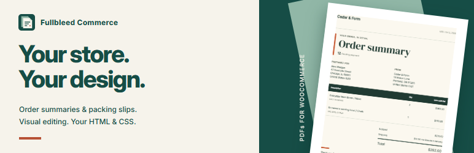

# WordPress directory artwork and preview

This directory and [`.wordpress-org`](../../.wordpress-org/) prepare the free
Fullbleed Commerce **0.1.6** listing. WordPress approved plugin hosting on October
9, 2026 after reviewing 0.1.5. The SVN repository is still empty as checked on
October 14; the public directory listing and these assets are not live. The
published plugin ZIP is not modified by this artwork build.



The artwork uses Fullbleed Commerce's existing icon, colors and an actual PDF
from its fictional Cedar & Form sample store. Four images show the free document
screen, visual editor, HTML/CSS editor, and resulting PDF. No paid automation
feature is represented as included in the free plugin.

## Files and publication

The publishing workflow copies the **contents** of `.wordpress-org` to the SVN
repository's top-level `assets/` directory, outside `trunk` and version tags:

- `banner-772x250.png` and `banner-1544x500.png`
- `icon.svg`, `icon-128x128.png` and `icon-256x256.png`
- `screenshot-1.png` through `screenshot-4.png`
- `blueprints/blueprint.json`

The generated [readme.txt](readme.txt) is the **0.1.6 release readme plus four
screenshot captions and the optional GitHub Sponsors link**. The funding
profile is public; anonymous page access and GitHub's `isPublic` field were
checked on October 6, 2026. Use these metadata additions in the matching approved
readme; do not overwrite a later release's metadata with this copy. The images
meet the dimensions, filename and size rules in the
[WordPress asset handbook](https://developer.wordpress.org/plugins/wordpress-org/plugin-assets/).

The Blueprint is an exact copy of the repository's tested public sample-store
configuration, pinned to the free 0.1.6 ZIP. It installs WooCommerce and fictional
orders, opens Fullbleed's document screen, and disables outgoing mail and
WordPress networking. After uploading it, use the directory's **Test Preview**
and verify an actual PDF download before setting the preview to public in the
plugin's Advanced view. WordPress describes both required steps in its
[preview handbook](https://developer.wordpress.org/plugins/wordpress-org/previews-and-blueprints/).

## Reproduce

Use Python with `tools/browser-requirements.txt` and Google Chrome. Download the
free ZIP from the matching GitHub release; the artwork builder verifies its
SHA-256 before using its bundled Inter font.

```sh
node tools/check-playground.mjs --serve
# In another terminal, while the disposable local store is running:
python tools/capture-wordpress-directory.py --url http://127.0.0.1:9488 \
  --version 0.1.6 --local-verification output/playground/local-verification.json \
  --require-fonts --require-local-icons
python tools/build-wordpress-directory.py \
  --plugin-zip dist/fullbleed-commerce-0.1.6.zip \
  --sample-preview path/to/verified-sample-order.png
```

The capture launches and closes its own anonymous browser. It permits a temporary
public Playground or the verified loopback sample store, checks the free plugin version and actual PDF
bytes, requires local icon assets, loaded canvas fonts and readable typography controls, and saves
native UI screenshots. Candidate-editor injection is available for development;
the artwork builder explicitly refuses those captures as released UI evidence.

Use the [sample PDF](sample-order.pdf) and [preview](../../.wordpress-org/screenshot-4.png)
identified by [verification.json](verification.json); their checksums are pinned by
the builder along with the release ZIP. The preview was rendered with PDFium at
4/3 scale (794 by 1123 pixels). October 14 captures use local WordPress 7.1.3,
WooCommerce 11.1.2 and Chrome 155. They establish the plugin's actual UI and PDF
output, not public Playground availability. Browser requests during plugin use
were restricted to the local store; mail and WordPress networking were disabled.
The banner combines that real output with HTML/CSS and the existing SVG icon;
the screenshot images are not UI mockups. The record includes hashes, sizes,
dimensions, browser version, and the capture checks. Refresh the pinned ZIP
checksum and recapture after a plugin release; inspect every final image before
uploading directory changes.

## Publish the verified release

[`publication.json`](publication.json) pins the public free ZIP, its release
evidence and source commit. `tools/prepare-wordpress-release.py` verifies those
inputs, every listing asset and the preview Blueprint before staging files.
Only `readme.txt` differs from the released plugin, by the screenshot captions
and optional donation link. All executable files, bundled fonts, source and
licenses remain byte-for-byte copies. The separate Pro package is excluded.

The **Prepare or publish WordPress directory release** workflow runs a credential-free
SVN rehearsal on pull requests and relevant `main` changes. It verifies the
actual staged `trunk`, version tag and assets against the retained file manifest.
It does not publish on a push, tag or GitHub release event.

To enable publication, save the WordPress.org **SVN password** as the repository
or `wordpress` environment secret `WORDPRESS_SVN_PASSWORD`. The username is
`kfinkelstein`. WordPress requires a separate SVN password, available in
[Account & Security](https://profiles.wordpress.org/me/profile/edit/group/3/?screen=svn-password);
do not use the account login password or put it in source or logs.

Run the workflow manually on `main` with **publish** enabled. It prepares and
rehearses the same pinned release first, then commits the tag, trunk and assets
in one SVN transaction and independently exports the public files for checksum
verification. The generated plugin-directory ZIP may have a different archive
checksum because of packaging and the readme additions; compare its individual
files with the workflow manifest. Confirm the public directory page, version,
download, screenshots and donation link before announcing availability. The
preview remains disabled until WordPress's **Test Preview** succeeds.
